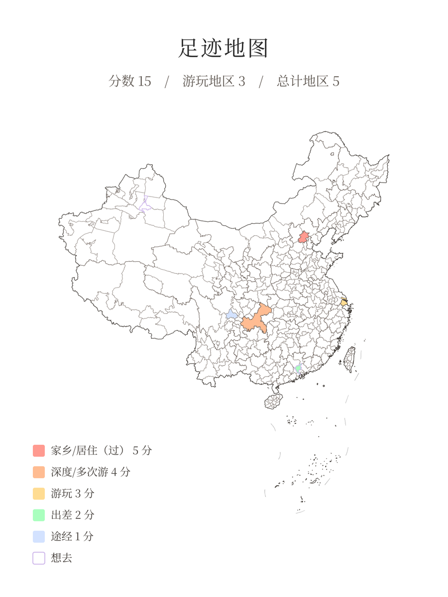
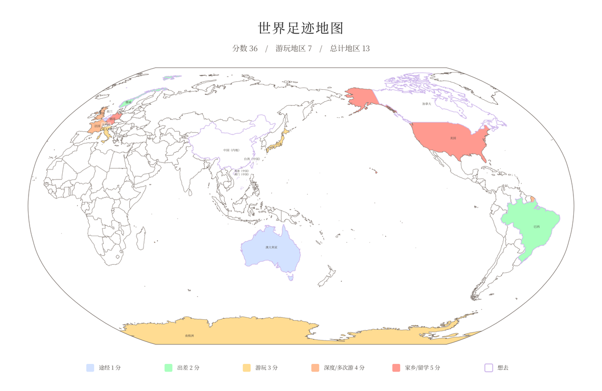

# 足迹地图

[打开新版足迹地图](https://alexxpowered.top/footprint-map/) · [旧站与一键迁移](https://alexx-powered.github.io/footprint-map/)

当前版本：**v1.1.1**。

中国版与世界版已合并在同一个 `index.html` 中。顶部可切换，每次打开默认显示中国足迹地图；来回切换保留各自的地图视角与记录。两版地图、字体和脚本全部内嵌。

- 点击地区选择等级：途经 1 分、出差 2 分、游玩 3 分、深度游 / 多次游玩 4 分、家乡/居住（过）5 分。
- 中国版按市级行政单位计分，采用官方Albers投影；世界版使用可旋转、拖动和缩放的罗宾森投影，按国家及地区计分，包含南极洲。具体归属、港澳合并计分和显示配色规则见各自地图说明。
- 支持搜索、撤销、手机双指缩放、JSON 一键复制及粘贴或文件导入。
- “想去”用浅紫色（#CDB7EB）沿原行政边界标记，相邻地区共用一条描边，可独立开关并叠加途经、出差，保留原色与分数；标记本身不增加分数或地区数量；可选择三档描边粗细，线宽随缩放调整，世界版线条更细。
- 中国版导出 6000 × 8000 像素图片；世界版导出 8000 × 5200 像素图片，并标注已记录地区的名称；名称优先放在本国境内，小国用定位点和引线明确对应。手机可预览并长按保存。

## 更新内容

- **v1.1.1** 「想去」统一改用图例取色的浅紫色（#CDB7EB），同步更新地图、图例与导出图片。
- **v1.1.0** 将「想去」改为淡兰紫共享边界，网页、图例和图片导出同步更新。地图说明默认展开最新版本系列，早期系列可分别展开。
- 迁移弹窗底部显示带星号的完整仓库地址。每次点击「一键迁移」使用独立的请求地址，避免复用上一次迁移页的缓存。

## 导出示例

以下图片由 v1.1.1 使用示例记录导出。

| 中国足迹 | 世界足迹 |
| --- | --- |
|  |  |

## 本地记录

足迹仅保存在当前浏览器本机，不会上传。中国版与世界版分别保存、分别导入导出 JSON，不会相互覆盖。从旧站换到新站时，可在旧站点「一键迁移」带上中国和世界两版记录。若新站已有记录，弹窗会先提示替换范围。跨设备或跨浏览器时，可用 JSON 备份恢复。

## 本地使用与发布

保存并打开 `index.html`，或使用本地静态 HTTP 服务预览。GitHub Pages 从 `main` 分支根目录发布，更新 `index.html` 后推送即可。

地图数据和字体等第三方资源的来源、许可见页面内地图说明和内嵌源码。二次创作须注明原作者 **Alexx-Powered** 及 [GitHub 原项目](https://github.com/Alexx-Powered/footprint-map)，并保留原署名声明。
